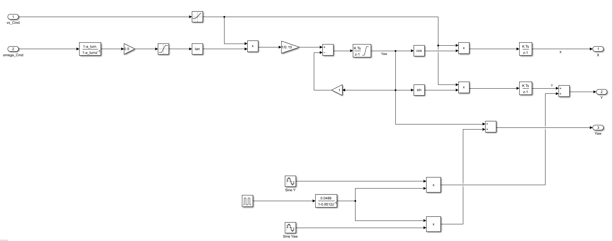

# Guardian Mission: Integrated Battery, Sensing and Vehicle Simulation


A closed-loop **Simulink** project that links a **LiFePO4 battery digital twin**, a **three-sensor driving decision unit** and a **Stateflow mission supervisor** to a **3D car** with working brake lights, turn signals and headlights.

The idea: the battery decides how the car is allowed to drive, and the way the car drives decides how fast the battery drains.

<!-- Add a demo video or GIF here, for example:  -->


---

## Table of contents

1. [Features](#features)
2. [System overview](#system-overview)
3. [Subsystems](#subsystems)
4. [Kinematics: from inputs to outputs](#kinematics-from-inputs-to-outputs)
5. [3D model and vehicle lights](#3d-model-and-vehicle-lights)
6. [Results](#results)
7. [Requirements](#requirements)
8. [How to run](#how-to-run)
9. [Repository structure](#repository-structure)
10. [Key parameters](#key-parameters)
11. [Known limitations and future work](#known-limitations-and-future-work)
12. [Author](#author)
13. [License](#license)

---

## Features

- **Battery digital twin** of a 3.2 V, 50 Ah LiFePO4 cell: equivalent circuit with two RC branches, Coulomb counting, open-circuit voltage with hysteresis, an Extended Kalman Filter for state of charge (SOC) and total least squares for internal resistance and state of health (SOH).
- **Sensor chain** with three distance sensors, debounce and self-healing logic, and a decision block that picks FORWARD, TURN_L, TURN_R, IDLE or STOP.
- **Mission supervisor** (Stateflow) with NOMINAL, LOW_POWER, CELL_FAULT and RTB_STOP modes. It cuts speed on low power and stops the car on an emergency stop or a critical battery, with automatic charging.
- **Vehicle kinematics** using a bicycle model with smoothed speed and steering and a heading-return loop, so the car can never spin.
- **Weaving manoeuvre** (the car swings right and left while moving forward), built from standard Simulink blocks with no MATLAB Function block.
- **3D car with live lights**: brake lights when slowing or stopped, turn signals from the sign of the steering command, headlights always on.

---

## System overview

Data flows from left to right in four stages: scenario inputs, sensor processing, mission supervision with the battery, and finally the kinematics with the 3D model.


| Block | Role |
|---|---|
| Signal Editor (`ds`) | Supplies the test scenario: three sensor voltages, `Emergency_Stop_Cmd` and `Reset_Cmd` |
| Calibration gains | Correct the front, right and left sensor voltages (1.0053, 1.0165, 1.0029) |
| Rover Model (`Guardian_Top_session_for_integrated`) | Turns sensor voltages into distances, an active state and `Speed_cmd` |
| `Mission_Supervisor` | Stateflow chart producing `Mission_status`, `vx_Cmd` and `omega_Cmd` |
| Generate Current | Converts `Speed_cmd` and `Mission_status` into the load or charging current |
| Battery Model (`Guardian_Battery_for_integrated`) | Outputs `SOC_CC`, `SOC_Flag`, `V_terminal`, `R0_TLS` and `SOH_ratio` |
| Kinematics | Turns `vx_Cmd` and `omega_Cmd` into X, Y and Yaw |
| 3D_Model | Draws the car in the 3D scene and drives its lights |

---

## Subsystems

### Sensor processing and decision

Each sensor voltage (0 to 5 V) is limited and converted to a distance in centimetres, and a switch sets a "close" flag. A Stateflow debounce block needs `N_confirm = 3` consecutive samples to accept a change, and treats readings outside 0 to 500 cm as invalid until `N_heal = 3` valid samples return. The decision block outputs `Active_State_dis` and `Speed_cmd` (IDLE 50, FORWARD 100, TURN 25, STOP 0).

### Mission supervisor

| State | `Mission_status` | Behaviour |
|---|---|---|
| NOMINAL | 1 | Normal driving at `vx_FORWARD` (0.5 m/s) |
| LOW_POWER | 2 | `SOC_CC < SOC_Warn` or `SOH_ratio < SOH_Min`. Reduced speed `vx_REDUCED` (0.2 m/s) |
| CELL_FAULT | 3 | Entered when the battery estimator raises `SOC_Flag`. Reduced speed |
| RTB_STOP | 4 | Entered on `Emergency_Stop_Cmd`, `SOC_CC < SOC_Critical` or `V_terminal < V_min`. The car stops and charging starts. `Reset_Cmd` returns to the previous mode, and bounces back if the cause is still present |

A positive `omega_Cmd` means a left turn and a negative one a right turn.

### Current generation and battery

The speed command is mapped to a load current (IDLE 20 A, FORWARD 40 A, TURN 10 A, STOP 0 A). In RTB_STOP the charging current (-25 A) is used instead. A first-order filter (time constant 2 s) smooths the current before it enters the battery model.

---

## Kinematics: from inputs to outputs

| Port | Direction | Description |
|---|---|---|
| `vx_Cmd` | Input 1 | Forward speed command (m/s) |
| `omega_Cmd` | Input 2 | Turn command (+0.5 left, -0.5 right, 0 straight) |
| `X` | Output 1 | Position along the road (m) |
| `Y` | Output 2 | Sideways position (m) |
| `Yaw` | Output 3 | Heading (rad) |



**Signal flow**

1. **Smooth the speed:** `vx_Cmd` goes through a Rate Limiter (rising 0.5 m/s², falling -1 m/s²) to give the real speed `v`.
2. **Smooth the steering:** `omega_Cmd` goes through a discrete filter with a 0.5 s time constant (`a_turn = exp(-Ts/0.5)`).
3. **Steering angle:** a gain of 0.5 and a saturation of ±0.5 rad give δ.
4. **Bicycle model:** yaw rate = `v · tan(δ) / L` with wheelbase `L = 0.15 m`.
5. **Heading-return loop:** the current Yaw is subtracted, so the heading returns to straight when the steering returns to zero.
6. **Integrate the heading:** a Discrete-Time Integrator limited to ±0.4 rad gives Yaw.
7. **Integrate the position:** `X = ∫ v·cos(Yaw) dt` and `Y = ∫ v·sin(Yaw) dt`.
8. **Weaving manoeuvre:** a Pulse Generator (period 1000 s, width 24 s, delay 30 s) is smoothed and multiplies two sine waves (amplitudes 0.6 and 0.5, frequency 0.6 rad/s, 90° apart). The results are added to the Y and Yaw outputs, so the car weaves between 30 s and 54 s.

**Why the original version spun:** the turn command was integrated straight into the heading. A 60 s turn at 0.5 rad/s adds 30 rad, almost five full rotations. The heading limit, the heading-return loop and the bicycle model fix this.

---

## 3D model and vehicle lights

The `Simulation 3D Vehicle with Ground Following` block (muscle-car body) receives X, Y and Yaw from the kinematics. Its **Light controls** port takes one **[1x6] `uint8` row vector**. The order of the six positions was found by testing each one:

| Position | Lamp | Signal driving it |
|---|---|---|
| 1 | Low beam | Constant 1 (always on) |
| 2 | High beam | Constant 0 |
| 3 | Brake lights | Stopped (`v < 0.01`) **OR** slowing down (acceleration `< -0.05`) |
| 4 | Reverse lights | Constant 0 |
| 5 | Left turn signal | `omega_Cmd > 0.05` |
| 6 | Right turn signal | `omega_Cmd < -0.05` |


**How it is built**

1. Enable light controls on the vehicle block.
2. Pass `vx_Cmd` through a Rate Limiter with the same settings as the kinematics, so the lights follow the real speed.
3. Branch it: one branch to *Compare To Constant* (`< 0.01`), the other to a *Discrete Derivative* and *Compare To Constant* (`< -0.05`).
4. Combine them with a *Logical Operator* (OR) and convert to `uint8`.
5. Turn signals: two *Compare To Constant* blocks on `omega_Cmd`.
6. Join the six signals with a *Mux*, then a *Reshape* block set to `[1, 6]`, then a *Data Type Conversion* to the port.

The turn signals blink by themselves, because the block's own period (1 s) and pulse width (50 %) are used.

---

## Results

The speed command stays at 0.5 m/s and falls to zero at the right turn (about 20 s), the left turn (about 60 s) and the emergency stop (about 250 to 260 s). `omega_Cmd` shows -0.5 rad/s for the right turn and +0.5 rad/s for the left turn.


The battery current settles at 40 A while driving, dips at the turns, and becomes -25 A (automatic charging) during the emergency stop.


The terminal voltage falls from about 3.30 V to 3.13 V, and SOC falls almost linearly from 80 % to about 49.5 % over 1400 s. This matches the hand calculation: 40 A for 1400 s is about 15.6 Ah, which is about 31 % of 50 Ah.


For a fast demonstration of LOW_POWER, CELL_FAULT and RTB_STOP, set `Q_nominal = 12` Ah. The expected milestones are LOW_POWER at about 630 s, CELL_FAULT at about 846 s and RTB_STOP at about 900 s, then a premature reset at 901 s (it must bounce back) and a successful reset at 950 s.

---

## Requirements

- MATLAB **R2025b** and Simulink
- Stateflow
- The Simulink 3D simulation blocks (*Simulation 3D Scene Configuration* and *Simulation 3D Vehicle with Ground Following*). Run `ver` to check that your license includes them.
- A computer able to run the 3D window (a graphics card helps)

---

## How to run

1. Copy all the repository files into one folder and set it as the MATLAB current folder. The models reference each other, so keep them together.
2. Make sure the two CSV files have the names that `Integrated_Project_Script.m` reads (it uses `Guardian_Battery_DriveCycle_Current (1)` and `Guardian_Battery_OCV_SOC_Table (1)`), or edit the file names in the script.
3. Run `Integrated_Project_Script.m`. It defines all parameters and buses and creates `scenario_FINAL_ceremony.mat`.
4. Open `Integrated_Project.slx` and check the solver: **Fixed-step, ode1, step size 0.1**. The same setting is needed in the referenced models.
5. Set the stop time (for example `1000`) and turn on **Simulation Pacing** at 1× so the 3D scene runs in step with simulation time.
6. Click **Run**. Watch the car in the 3D window and the plots in the *Scopes* area.

---

## Repository structure

```
guardian-mission-simulink/
├── Integrated_Project.slx                        # top-level model
├── Guardian_Battery_for_integrated.slx           # battery digital twin
├── Guardian_Top_session_for_integrated.slx       # sensor chain and decision logic
├── SensorProcessing_session_for_integrated.slx   # single-sensor conversion
├── Integrated_Project_Script.m                   # parameters, buses and scenario
├── scenario_FINAL_ceremony.mat                   # test scenario created by the script
├── Guardian_Battery_DriveCycle_Current (1).csv
├── Guardian_Battery_OCV_SOC_Table (1).csv
├── Integrated project.pdf                        # full technical report
├── images/                                       # figures used in this README
├── LICENSE
└── README.md
```

---

## Key parameters

| Parameter | Value | Meaning |
|---|---|---|
| `Ts` | 0.1 s | Fixed sample time |
| `SOC_Warn` / `SOC_Critical` | 30 % / 5 % | LOW_POWER and RTB_STOP thresholds |
| `SOH_Min` | 90 % | LOW_POWER threshold |
| `V_min` | 2.5 V | RTB_STOP threshold |
| `vx_FORWARD` / `vx_REDUCED` | 0.5 / 0.2 m/s | Cruise and reduced speeds |
| `omega_TURN` | 0.5 rad/s | Turn command magnitude |
| `Charging_Current` | -25 A | Charging while stopped |
| `Q_nominal` | 50 Ah | Cell capacity (12 Ah for the fast demo) |
| `R0`, `R1`, `C1`, `R2`, `C2` | 0.7 mΩ, 1.6 mΩ, 17 kF, 0.35 mΩ, 5.2 kF | Equivalent-circuit constants |

---

## Known limitations and future work

- The supervisor sets `vx = 0` during a turn, and the bicycle model needs forward speed, so the car barely changes heading during the short turn pulses. A small forward speed during turns would give a visible arc.
- The scenario turns last 3 s, so the turn signals blink only a few times. Longer turns make them easier to see.
- Live engine sound inside Simulink needs a much smaller step than the models allow. Generating a sound file from the logged speed is the recommended approach.
- Ideas: hazard lights during the emergency stop, a night scene with high beams, and obstacles in the 3D scene placed to match the sensor distances.

---

## Author

**Nagy Elbaz**
GitHub: [@nagyelbaz](https://github.com/nagyelbaz)

---

## License

This project is released under the [MIT License](LICENSE).
